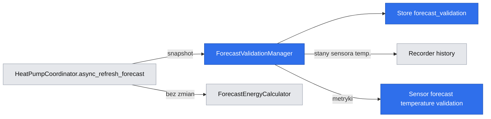
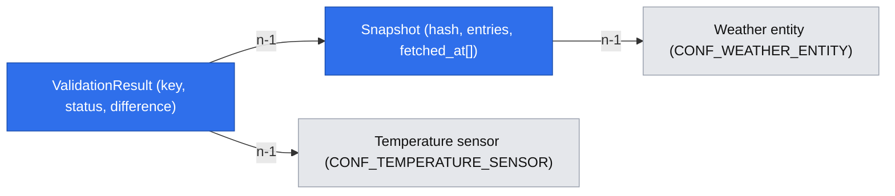

# Etap 1 walidacji temperatur prognozy (obserwacja bez korekty)

Brief: `.ai/specs/briefs/2026-11-06-forecast-temperature-validation.md` · Tracker: GitHub issue #2 (świadomy wyjątek od lokalnego trackera; przyszły etap korekty dostaje nowe issue).

## 📝 TLDR
Użytkownik nie może dziś ocenić, jak bardzo prognozowana temperatura różniła się od temperatury zarejestrowanej przy obserwowanej pompie ciepła, bo `HeatPumpCoordinator._forecast` jest nadpisywany co 30 minut. **Proponowane (przyszłe) zachowanie:** integracja zapisuje w osobnym `Store` niezmienne snapshoty prognozy godzinowej (28 dni), po upływie okna docelowego waliduje je względem średniej ważonej czasem z historii Recorder i publikuje jeden sensor diagnostyczny z agregatami per przedział horyzontu. Istniejące prognozy energii pozostają bez zmian; korekta jest poza zakresem.

## 📝 Problem Statement
Brak trwałych danych uniemożliwia ocenę, czy lokalny, stabilny błąd temperatury prognozy uzasadnia późniejszą korektę. Porównanie prognozy punktowej z pomiarem godzinnym łatwo pomylić z błędem prognozy, dlatego wszystkie wyniki są nazwane **„różnica prognozy punktowej względem średniej godzinnej"** i nigdy nie są prezentowane jako bias gotowy do zastosowania.

## 📝 Stan obecny (z kodu)
- `coordinator.py::async_refresh_forecast` woła `weather.get_forecasts` (`type: hourly`), nadpisuje `self._forecast`, nie zapisuje czasu pobrania.
- `sensors/forecast_cache.py::HeatPumpForecastSensor` odświeża co 30 min (`async_track_time_interval`) i przy dodaniu do HA.
- `forecast_energy.py` konsumuje `coordinator.forecast` — nie może się zmienić.
- `Store` `heat_pump_predictor.<entry_id>` zawiera tylko kubełki (`data_manager.to_dict`).
- `manifest.json`: `requirements: []`, brak zależności od Recorder.
- Nie ma wcześniejszych specyfikacji w `.ai/specs/` (brak `Extends`/`Supersedes`, brak driftu).

## 📝 Proposed Solution
1. **Capture** — po udanym pobraniu prognozy `async_refresh_forecast` przekazuje odpowiedź do menedżera walidacji, który zapisuje skrócony, niezmienny snapshot. Błąd zapisu jest logowany i nie psuje `_forecast`.
2. **Validate** — co godzinę (minuta :10) menedżer wyznacza okna docelowe, które zakończyły się ≥ 10 min temu i nie mają wyniku, oblicza temperaturę rzeczywistą z Recorder i zapisuje wynik.
3. **Publish** — sensor `Forecast temperature validation` agreguje wyniki z ostatnich 14 dni (wg `target_at`) per przedział horyzontu.

Alternatywy odrzucone (z briefu): czekać z całością do decyzji o korekcie (dane mają niezależną wartość); nie zmieniać nic (nadpisywany cache nie pozwala odtworzyć oceny). Rozważone i odrzucone: dokładanie snapshotów do głównego `Store` kubełków — rozrost pliku i ryzyko dla danych modelu; osobny klucz izoluje retencję i awarie.

### Definicje
- **Cel prognozy** `target_at`: pole `datetime` wpisu prognozy, tylko pełne godziny (`minute == second == 0`); inne wpisy nie są zapisywane.
- **Horyzont** = `target_at − fetched_at` (h). Kwalifikują się tylko snapshoty z `fetched_at < target_at`.
- **Przedziały horyzontu** (klucze ASCII, stabilne): `0_3h`, `3_6h`, `6_12h`, `12_24h`, `24_48h`; przedział `[a, b)` z `a ≥ 3`, a pierwszy to `(0, 3)`. Wpisy z horyzontem ≤ 0 lub ≥ 48 h nie są zapisywane.
- **Snapshot reprezentujący** okno: dla każdej trójki `(weather_entity, target_at, przedział)` — ostatni snapshot pobrany przed `target_at`, którego horyzont mieści się w przedziale (jedna próbka na trójkę).
- **Temperatura rzeczywista**: średnia ważona czasem ze stanów skonfigurowanego `CONF_TEMPERATURE_SENSOR` w `[target_at, target_at + 1h)` ze stanem obowiązującym na początku okna (`include_start_time_state`). Przedziały `unknown`, `unavailable`, wartości nienumeryczne i niekończone są wykluczone (bez przedłużania poprzedniej wartości przez znany niedostępny okres).
- **Pokrycie** = suma sekund z poprawnymi danymi / 3600. Walidacja wymaga ≥ 0,60; inaczej `unvalidated`.
- **Różnica** = `forecast_temperature − actual_mean` (°C, ze znakiem).

## 📝 Delta

### Capability: forecast-temperature-validation

#### ADDED Requirement: Niezmienne snapshoty prognozy
The system SHALL zapisywać przy każdym udanym pobraniu prognozy godzinowej snapshot (wpisy `target_at`, temperatura, czas pobrania, encja pogodowa) bez modyfikowania wcześniej zapisanych snapshotów.

##### Scenario: Pobranie prognozy
- WHEN koordynator pobierze prognozę godzinową z poprawną temperaturą
- THEN snapshot z `fetched_at` jest dostępny w magazynie, a `coordinator.forecast` i wyniki `calculate_forecast_energy` są identyczne jak przed zmianą

##### Scenario: Identyczna zawartość
- WHEN kolejne pobranie daje wpisy o tej samej zawartości (ten sam hash) co istniejący snapshot
- THEN zawartość nie jest duplikowana, a do istniejącego rekordu dopisywany jest nowy `fetched_at`

#### ADDED Requirement: Walidacja godzinowa względem Recorder
The system SHALL po upływie okna `[target_at, target_at + 1h)` obliczyć średnią ważoną czasem temperatury rzeczywistej i zapisać wynik `validated` albo `unvalidated` z powodem.

##### Scenario: Wystarczające pokrycie
- WHEN poprawne dane pokrywają ≥ 60% okna
- THEN wynik ma status `validated`, `actual_mean`, `coverage` i różnicę prognozy punktowej względem średniej godzinnej

##### Scenario: Niewystarczające pokrycie
- WHEN poprawne dane pokrywają < 60% okna (w tym przez `unavailable`)
- THEN wynik ma status `unvalidated` z powodem `insufficient_coverage` i nie wchodzi do metryk

##### Scenario: Brak Recorder
- WHEN Recorder jest niedostępny lub wyklucza encję
- THEN wynik ma powód `recorder_unavailable` i walidacja jest ponawiana przez maks. 24 h od końca okna

#### ADDED Requirement: Diagnostyka per przedział horyzontu
The system SHALL publikować sensor diagnostyczny z metrykami z ostatnich 14 dni wg `target_at` (lub całej dostępnej historii), od pierwszej próbki, zawsze z liczbą unikalnych okien.

##### Scenario: Pierwsza próbka
- WHEN istnieje jedno zwalidowane okno
- THEN przedział zawiera `windows: 1` i metryki, a stan sensora jest równy łącznej liczbie zwalidowanych okien

##### Scenario: Brak danych
- WHEN nie ma zwalidowanych okien
- THEN stan sensora to `0`, przedziały mają `windows: 0` i `null` dla metryk

#### ADDED Requirement: Retencja
The system SHALL usuwać snapshoty i wyniki starsze niż 28 dni.

##### Scenario: Przycinanie
- WHEN snapshot ma wszystkie `fetched_at` starsze niż 28 dni lub wynik ma `target_at` starszy niż 28 dni
- THEN rekord jest usuwany przy następnym zapisie

#### ADDED Requirement: Brak wpływu na prognozy energii
The system SHALL NOT zmieniać temperatur wejściowych ani wyniku `calculate_forecast_energy` i sensorów zaplanowanych na podstawie danych walidacyjnych.

##### Scenario: Wynik bez zmian
- WHEN istnieją zwalidowane okna z niezerową różnicą
- THEN wynik `calculate_forecast_energy` dla tych samych danych wejściowych jest identyczny jak bez funkcji

## 📝 Architecture
**Główny moduł (nowy):** `custom_components/heat_pump_predictor/forecast_validation.py`.
- Czyste funkcje (wzór: `forecast_energy.py`, bez HA w testach jednostkowych): normalizacja i hash snapshotu, przypisanie przedziału horyzontu, wybór snapshotu reprezentującego, `time_weighted_mean(states, start, end)`, `aggregate_metrics(results, now)`.
- `ForecastValidationManager`: własny `Store` (`heat_pump_predictor.forecast_validation.<entry_id>`, wersja 1), `async_capture(weather_entity, forecast, fetched_at)`, `async_validate_due(now)`, `async_prune(now)`, rejestr callbacków odświeżających sensor. Odczyt Recorder: `recorder.history.get_significant_states` przez `get_instance(hass).async_add_executor_job`, `significant_changes_only=False`, `no_attributes=True`, `include_start_time_state=True`.
- **Reuse:** `Store` z HA (jak w koordynatorze), `dt_util`, wzorzec `HeatPumpBaseEntity`/`translation_key`, parsowanie `datetime` zgodne z `ForecastEnergyCalculator._parse_datetime` (wydzielić do wspólnej funkcji bez zmiany zachowania albo zduplikować z testem zgodności).
- **Zmiany w istniejących plikach:** `coordinator.py` (utworzenie menedżera, wywołanie `async_capture` w `async_refresh_forecast` w `try/except`, harmonogram `async_track_time_change(minute=10, second=0)`, zapis przy shutdown), `sensor.py` + `sensors/__init__.py` (nowy sensor, tylko gdy rozwiązano encję pogodową), `manifest.json` (`after_dependencies: ["recorder"]`), `strings.json`, `translations/en.json`, `translations/pl.json`.
- **Nie zmieniają się:** `forecast_energy.py`, `calculator.py`, `data_manager.py`, `sensors/scheduled_forecast.py`.
- **Zależność od przyszłej pracy:** brak; przyszła korekta będzie czytać wyniki walidacji, ale etap 1 nie definiuje dla niej kontraktu.


Wniosek: dane walidacyjne płyną wyłącznie do nowego sensora; ścieżka energii pozostaje odizolowana.

## 📝 Data Model
Magazyn (JSON, wersja 1, klucz `heat_pump_predictor.forecast_validation.<entry_id>`):

```
snapshots: {
  <content_hash>: {
    weather_entity: str,
    entries: [[target_at_utc_iso, temperature_float], ...],   # tylko pełne godziny, temp. skończona, 0 < target_at − fetched_at < 48h, liczone względem KAŻDEGO pobrania z osobna przed hashowaniem
    fetched_at: [iso_utc, ...]                                 # każde pobranie o tej (przyciętej) zawartości
  }
}
results: {
  "<weather_entity>|<target_at_utc_iso>|<range>": {
    snapshot_hash: str, fetched_at: iso, horizon_hours: float,
    forecast_temperature: float,
    status: "validated" | "unvalidated",
    reason: null | "insufficient_coverage" | "recorder_unavailable" | "no_recorded_states",
    actual_mean: float | null, coverage: float | null,
    difference: float | null, validated_at: iso
  }
}
```
Uwagi:
- Hash = SHA-256 kanonicznego JSON (`entries` posortowane po `target_at`, czas w UTC, temperatura jako zaokrąglony `repr`) plus `weather_entity`; deterministyczny między restartami.
- Przycięcie do okna (0, 48 h) następuje dla każdego pobrania względem jego własnego `fetched_at`, a hash liczony jest z przyciętych wpisów. Dwa pobrania mają ten sam hash tylko przy identycznym zbiorze `target_at` i temperatur, więc horyzont każdego pobrania wynika z jego `fetched_at` (zapisanego w rekordzie), nie z rekordu.
- Realny zysk z dedupu jest mały: pobranie 30 min później zwykle przesuwa zbiór `target_at`. Dedup głównie eliminuje zdublikowane wyzwalacze (start + interwał) i niezmienną prognozę w obrębie tej samej godziny.
- Wyniki są samowystarczalne (`forecast_temperature`, `horizon_hours`, `fetched_at`); usunięcie snapshotu przy retencji nie unieważnia wyniku. Kolejność: walidacja, potem przycinanie.
- Dane nie zawierają PII.
- Rozmiar (górne oszacowanie): ≤ 1344 pobrań w 28 dniach × ≤ 48 wpisów ≈ 65 tys. par, rzędu 2–3 MB JSON; plik zapisywany z `async_delay_save`.



## 📝 API Contracts
Brak nowych usług ani zmian istniejących. Nowy sensor:
- `unique_id`: `forecast_temperature_validation`, `entity_category: diagnostic`, `translation_key: forecast_temperature_validation`, jednostka `windows`, stan = liczba zwalidowanych unikalnych okien w okresie 14 dni.
- Stan sensora = liczba unikalnych par `(weather_entity, target_at)` mających ≥ 1 zwalidowany wynik w okresie (nie suma po przedziałach — to samo okno występuje w kilku przedziałach).
- Atrybuty: `period_start`, `period_end`, `weather_entity`, `ranges` (słownik po kluczach `0_3h`…`24_48h`, wartość: `windows`, `mean_difference`, `mae`, `rmse`; `null` gdy `windows == 0`), `unvalidated` (liczniki po powodzie), `description` (stała fraza „różnica prognozy punktowej względem średniej godzinnej; nie jest biasem do korekty").
- Metryki: `mean_difference` = średnia ze znakiem; `mae` = średnia |różnicy|; `rmse` = √(średnia różnic²). `windows` w przedziale = liczba wyników tego przedziału (jedno okno na `(weather_entity, target_at, przedział)`).
- Surowe snapshoty i wyniki nie są wystawiane (audyt przez pliki `.storage` w okresie retencji).

## 📝 UI/UX
Tylko sensor diagnostyczny z atrybutami i tłumaczeniami en/pl; brak nowych ekranów ani zmian config flow.

## 📝 Edge Cases & Failure Scenarios
- **Recorder niedostępny / encja wykluczona:** wynik `recorder_unavailable`, ponawianie ≤ 24 h, potem pozostaje `unvalidated`; sensor działa, a metryki pomijają takie okna.
- **Brak stanów w oknie i brak stanu początkowego:** `unvalidated`/`no_recorded_states`.
- **Restart HA w trakcie okna:** luka bez zapisów nie jest przedłużana; jeśli stan początkowy jest poprawny, a kolejnych zmian nie było, wartość obowiązuje do końca okna (to stan faktyczny, nie wypełnienie luki).
- **Przejście DST / strefa czasowa:** cała logika w UTC; porównanie z `target_at` po normalizacji do UTC.
- **Dostawca zwraca nie-godzinne kroki, brak/niefinitywna temperatura (`None`, `NaN`, tekst):** wpis pomijany przy zapisie, bez wyjątku.
- **Pusta lub błędna odpowiedź prognozy:** snapshot nie powstaje; `_forecast` zachowuje obecne zachowanie.
- **Błąd zapisu `Store`:** logowany, `_forecast` i sensory energii bez zmian; kolejny zapis próbuje ponownie.
- **Uszkodzony/nieznany format magazynu:** ignorowany z ostrzeżeniem, start z pustym stanem; kubełki nietknięte (osobny klucz).
- **Zmiana `weather_entity` w opcjach:** klucze zawierają encję; stare dane wygasają z retencją i nie mieszają się w metrykach (sensor agreguje bieżącą encję).
- **Zmiana jednostki sensora temp. (°F):** poza zakresem etapu 1 — oba szeregi traktowane tak jak w kubełkach (wartość stanu); do odnotowania w ograniczeniach.
- **Sensor tymczasowo `unavailable` na całą godzinę:** pokrycie 0 → `insufficient_coverage`.

## 📝 Risks & Impact Review
- **Zmiana definicji metryki (trudne do odwrócenia):** nazwy atrybutów i semantyka różnicy stają się kontraktem dla przyszłej korekty; etap 1 oznacza ją jako diagnostyczną. Zmiana semantyki wymaga nowej wersji schematu magazynu (`version`).
- **Rozmiar magazynu / I/O:** ograniczone skróceniem do 48 h, dedup po hashu i `async_delay_save`.
- **Obciążenie Recorder:** jedno zapytanie na godzinę dla zakresu nowych okien (do 24 h wstecz), wykonywane w executorze.
- **Wsteczna zgodność:** brak zmian w usługach, encjach istniejących i kluczu magazynu kubełków. Nowa zależność `after_dependencies` jest miękka; rollback = usunięcie sensora i klucza `Store`.
- **Brak zapisu = brak dowodu:** dane wcześniejsze niż wdrożenie nie powstaną; pierwsze metryki są dostępne po pierwszym zakończonym oknie.

## 📝 Rozstrzygnięte założenia (z rozmowy i domyślne)
| # | Decyzja | Źródło |
|---|---|---|
| Q1 | Jedna spec, Faza 1 = snapshoty, Faza 2 = walidacja i diagnostyka | odpowiedź |
| Q2 | Przedziały `0_3h, 3_6h, 6_12h, 12_24h, 24_48h` (bez `>48h`, zob. Q6) | odpowiedź „ok" + rekomendacja |
| Q3 | Ten sam `CONF_TEMPERATURE_SENSOR`; Recorder jako zależność miękka | odpowiedź + rekomendacja |
| Q4 | n, średnia ze znakiem, MAE, RMSE | „dodaj" = dodanie RMSE; P90 odrzucone przez użytkownika |
| Q5 | Jeden sensor diagnostyczny z atrybutami, bez ekspozycji surowych danych | odpowiedź + rekomendacja |
| Q6 | Osobny `Store`; wpisy skrócone do 48 h; dedup po hashu z zachowaniem wszystkich `fetched_at` | odpowiedź „osobny store" + rekomendacja dla reszty |

Potwierdzone przez użytkownika: Q4 bez P90 oraz skrócenie wpisów do 48 h (Q6).

## 📋 Phasing
- **Faza 1 — Snapshoty:** magazyn, capture, dedup, retencja. Wdrażalna samodzielnie; dane zaczynają się gromadzić.
- **Faza 2 — Walidacja i diagnostyka:** odczyt Recorder, wyniki, agregaty, sensor, tłumaczenia.

## 📋 Implementation Plan
Walidacja: `.\venv\Scripts\python.exe -m pytest tests/ -v`. Każdy krok zostawia działającą aplikację.

### Faza 1 — Snapshoty
1. **Czyste funkcje snapshotu** w `forecast_validation.py`: normalizacja wpisów (pełne godziny, skończona temp., UTC, horyzont < 48 h), hash, przypisanie przedziału. Test: `tests/test_forecast_validation_snapshots.py` (wejścia błędne, kolejność, determinizm hasha, granice przedziałów 3/6/12/24/48 h).
2. **Magazyn i dedup:** `ForecastValidationManager` z `Store`, `async_capture` dopisujący `fetched_at` przy identycznym hashu, `async_prune` (28 dni). Test: dedup, przycinanie, uszkodzony magazyn.
3. **Podpięcie do koordynatora:** menedżer tworzony w `HeatPumpCoordinator`, wywołanie w `async_refresh_forecast` w `try/except`, zapis przy shutdown. Test regresji: `coordinator.forecast`, `_build_coordinator_data` i wynik `async_calculate_forecast_energy` bez zmian (rozszerzyć `tests/test_forecast_energy_calculator.py` lub dodać test koordynatora), a błąd `Store` nie psuje odświeżenia.

### Faza 2 — Walidacja i diagnostyka
4. **Średnia ważona czasem:** `time_weighted_mean` + pokrycie; przypadki: stan początkowy, luki `unavailable`, wartości nienumeryczne/`inf`, jedno okno bez zmian stanu, pokrycie 59% vs 60%. Test jednostkowy.
5. **Wybór snapshotu reprezentującego** per `(entity, target_at, przedział)` z wieloma `fetched_at` (w tym zdublikowaną zawartością). Test: ostatni sprzed `target_at`, jeden na trójkę.
6. **`async_validate_due` z wstrzykiwanym źródłem historii:** wyniki `validated`/`unvalidated`; `recorder_unavailable` ponawiane ≤ 24 h, a `insufficient_coverage` i `no_recorded_states` są końcowe. Test z atrapą źródła historii.
6a. **Adapter Recorder:** `get_significant_states` przez executor, `after_dependencies: ["recorder"]` w `manifest.json`. Krok potwierdza kontrakt API dla zainstalowanej wersji HA i opóźnienie zatwierdzenia danych (okno ≥ 10 min po końcu; jeśli dane bywają niepełne, dodać jedno ponowienie `insufficient_coverage` w pierwszej godzinie).
6b. **Harmonogram:** `async_track_time_change(minute=10, second=0)` w koordynatorze, zwolnienie przy shutdown. Test: wywołanie walidacji o :10 i odpięcie.
7. **Agregaty:** `aggregate_metrics` (n, średnia, MAE, RMSE) z oknem 14 dni i krótszą historią, unikalność okien. Test jednostkowy, w tym `windows: 0`.
8. **Sensor diagnostyczny** `forecast_temperature_validation` w `sensors/` i `sensor.py`, `strings.json`, `translations/en.json`/`pl.json`. Test budowy encji i atrybutów (wzorzec `tests/test_bucket_sensor_dynamic_builder.py`), w tym brak sensora, gdy nie rozwiązano encji pogodowej.
9. **Archive the Delta:** utworzyć `.ai/specs/capabilities/forecast-temperature-validation.md` z wymaganiami z sekcji Delta (spec bez zmian), na PR implementacyjnym.

Śledzenie: lokalnie w `.scratch/forecast-temperature-validation/` (PRD + issues 01–03). GitHub issue #2 był jednorazowym wyjątkiem i nie jest aktualizowany ani zakładany ponownie.

## 🧪 Ograniczenia
Nie weryfikowałem zachowania `recorder.history` na żywej instancji HA ani dokładnego kontraktu `get_significant_states` dla zainstalowanej wersji; krok 6 powinien go potwierdzić. Brak MODIFIED/REMOVED w Delta, więc nie ma kroków charakteryzujących; ochronę istniejących zachowań zapewnia test regresji z kroku 3.
