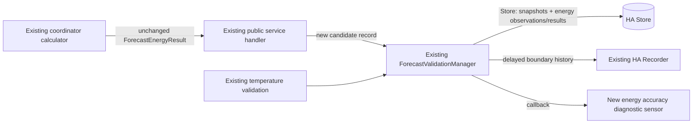

# Evaluate energy forecast accuracy against actual heat pump consumption

Extends: `.ai/specs/briefs/2026-11-06-forecast-temperature-validation.md` — reuses its `ForecastValidationManager` persistence, Recorder access, retry, pruning, and update-callback infrastructure; does not change temperature validation semantics.

## 📝 TLDR

Home Assistant users can call `calculate_forecast_energy`, but cannot later determine whether a returned kWh forecast matched the heat pump's cumulative energy meter. This proposal adds persistent, service-call-only energy forecast observations and validates each complete forecast window against Recorder data. A follow-up phase exposes an end-to-end accuracy diagnostic sensor using energy-weighted, time-decayed aggregates by forecast horizon, without changing the public service response or correcting forecasts.

## 📝 Problem Statement

The public `calculate_forecast_energy` service returns an energy forecast for a selected set of hourly forecast entries, while the actual cumulative energy sensor later records what the heat pump consumed. There is currently no durable link between those two observations. The existing Scheduled Forecast sensors are visualization consumers that call the coordinator directly and must not become validation samples.

The result must describe end-to-end forecast accuracy: weather forecast error, the learned power curve, and calculation behavior are all included. It is not a diagnostic of the energy model in isolation. Accuracy is `predicted_kwh / actual_kwh × 100`; 100% is exact, 80% is underprediction, and 120% is overprediction.

## 📝 Proposed Solution

Extend `ForecastValidationManager` rather than creating a parallel validation module. The service handler records a successful call after the coordinator returns, using the actual first and last `hours[].datetime` values from the result. It stores `called_at`, `window_start`, `window_end`, and `predicted_kwh`; `starting_hour` is not used to derive dates because the calculator may select the next day's matching hour.

When a window has matured, the manager reads the configured cumulative energy sensor from Recorder using the same entity selection path as the learning coordinator. It obtains the last known state at or before each boundary (`include_start_time_state`), computes `state(window_end) - state(window_start)`, and keeps a durable validated or skipped result. A short post-window delay allows Recorder to commit the final reading. Existing temperature snapshot/result shapes, metrics, and sensor contract remain unchanged.

Alternatives rejected by the brief are recording direct coordinator calls (which would include Scheduled Forecast), creating a new validation module, computing one unweighted average ratio, and building nothing.

## 📝 Delta

### Capability: energy-forecast-validation

#### ADDED: Persist service forecast observations

- **WHEN** `calculate_forecast_energy` returns successfully from a public service call
- **THEN** the integration records one candidate containing the call time, the result-derived window boundaries, and the unrounded total predicted kWh, without changing the response body.
- **WHEN** the same `(window_start, window_end)` is observed more than once
- **THEN** the oldest call wins, preserving the largest forecast horizon; later duplicates do not create additional validation samples.

#### ADDED: Validate a complete energy window

- **WHEN** a stored window has passed `window_end` plus the validation delay
- **THEN** Recorder is read for the configured cumulative energy sensor, including the state at each boundary, and actual consumption is the end reading minus the start reading.
- **WHEN** either boundary is unavailable, the sensor is unavailable, the difference is negative, the Recorder remains unavailable after retries, or required forecast hours are missing
- **THEN** the result is skipped with a stable reason and is not included in accuracy aggregates; a missing forecast-hour window is never partially summed.

#### ADDED: Publish energy accuracy diagnostics

- **WHEN** at least three eligible validated samples exist and their decayed actual-energy sum is positive
- **THEN** the main diagnostic sensor publishes the aggregate energy-weighted EWMA accuracy and exposes per-horizon buckets and sample details as attributes.
- **WHEN** a single sample has less than `0.2 kWh` actual energy
- **THEN** its individual accuracy is `null` with reason `actual_too_small`, while the raw observation remains available for audit; the aggregate still uses its predicted/actual energy pair because there is no aggregate energy threshold.

## 📝 Architecture



The service handler in `custom_components/heat_pump_predictor/__init__.py` is the only registration point. `coordinator.async_calculate_forecast_energy` continues to calculate and return the existing `ForecastEnergyResult`; Scheduled Forecast sensors therefore do not register samples. `forecast_energy.py` remains the source of the selected hourly timestamps and total. `coordinator.py` supplies the configured energy entity to the manager and triggers due validation on the existing schedule, including after startup.

The manager should separate temperature and energy namespaces in its persisted data or use an explicit schema discriminator so existing temperature results cannot be interpreted as energy results. Storage migration must retain existing temperature data. The existing temperature sensor callback remains unchanged; the Phase 2 energy sensor may register its own callback against the same manager update notification.

## 📝 Data Model

Persist an energy observation keyed by a stable window key derived from `(window_start, window_end)`:

```text
EnergyObservation
  called_at: ISO datetime
  window_start: ISO datetime
  window_end: ISO datetime
  selected_hours: ordered list of ISO datetimes
  predicted_kwh: finite non-negative number
  horizon_hours: ceil((window_end - called_at) / 1 hour)
  horizon_bucket: <=3h | 4_6h | 7_12h | 13_24h | >24h
  status: pending | validated | skipped
  actual_kwh: number | null
  accuracy_percent: number | null
  reason: string | null
  validated_at: ISO datetime | null
```

Store the observation and its validation result in the existing per-config-entry `Store`. Persist the ordered selected hourly datetimes (and requested/returned count) so validation can prove that the window was complete rather than inferring completeness from only its boundaries and total. Retain validated and skipped records for 30 days after their verification attempt; pending records remain until they can be validated or the Recorder retry window expires, then become `recorder_unavailable` and enter the same retention policy. The oldest candidate wins deduplication. Use the energy sensor selected in the config entry/options path; do not introduce a second sensor selector in this feature.

For each horizon bucket, maintain EWMA sums `P`, `A`, and the number of eligible evaluations. On a new evaluation ordered by `window_end`, decay both sums by `exp(-ln(2) × Δt / T½)` and add predicted and actual energy. The aggregate accuracy is `P / A × 100%`; the default half-life is seven days and is configurable through the integration options. Keep enough timestamped aggregate state to apply decay deterministically after restart and when results are evaluated out of order. An effective sample count should expose the decayed contribution separately from the integer count.

## 📝 API Contracts

The public Home Assistant service contract for `calculate_forecast_energy` is unchanged: request fields, response fields, values, and shape remain compatible. Candidate recording is an internal side effect after a successful response and must not add response fields or make a successful service call fail solely because persistence is unavailable; log the persistence failure and preserve the returned result.

The new diagnostic sensor publishes:

- native value: aggregate accuracy percentage, or `unknown` before three eligible evaluations or when the decayed actual sum is zero;
- attributes: an explicit end-to-end description, period/half-life, integer and effective sample counts, the arithmetic average accuracy of the latest ten eligible individual evaluations, per-bucket accuracy/counts, and the most recent evaluation (`predicted_kwh`, `actual_kwh`, `accuracy`, `horizon`, status/reason). The latest-ten value excludes skipped evaluations and individual results whose accuracy is undefined because `actual_kwh < 0.2`.

Use stable reasons `no_boundary_reading`, `sensor_unavailable`, `negative_difference`, `recorder_unavailable`, `actual_too_small`, and a reason for incomplete forecast hours. Do not expose a fabricated zero accuracy for skipped or undefined results.

## 📝 UI/UX

This is a diagnostic entity, not a control surface. Add a translated diagnostic sensor with a name that clearly says energy forecast accuracy and a description that says it is end-to-end accuracy, including weather and power-curve effects. Attributes should make the current aggregate explainable without requiring users to inspect Store data: horizon buckets, sample counts, effective sample counts, half-life, and the latest observation.

The options flow adds a positive duration setting for EWMA half-life, defaulting to seven days. Invalid, zero, or negative values are rejected. The energy sensor remains the configured cumulative kWh sensor; changing it through the existing options flow follows the current integration reload behavior. Scheduled Forecast sensors remain present and unchanged in this feature; their later removal is explicitly out of scope.

## 📝 Edge Cases & Failure Scenarios

- **Next-day selection:** derive boundaries from returned hourly datetimes, not from `starting_hour`, so a matching hour selected tomorrow is recorded correctly.
- **Incomplete forecast:** reject the candidate for validation rather than summing the available hours.
- **Recorder boundary:** request `include_start_time_state` and select the last known state no later than each boundary. No age limit is applied because Recorder may persist only changes.
- **Quantization:** the configured meter's `0.01 kWh` resolution creates at most `0.01 kWh` uncertainty per boundary and `0.02 kWh` per window; actual below `0.2 kWh` has no individual percentage.
- **Counter reset:** a negative difference is skipped and never contributes to EWMA.
- **Unavailable sensor:** unavailable/unknown/non-numeric boundary states are skipped with a reason; the manager retries Recorder failures and persists pending work across restart.
- **Restart:** on startup, load Store data and validate all matured pending observations on the next scheduled manager pass.
- **Out-of-order completion:** process accepted evaluations in `window_end` order for EWMA. A duplicate window cannot replace the oldest call.
- **Small sample:** aggregate remains unknown until three eligible evaluations and positive actual-energy mass; no additional energy threshold is introduced.

## 📝 Risks & Impact Review

The primary compatibility risk is accidentally changing the public service response or allowing persistence/Recorder failures to turn a successful service call into an error. Tests must characterize the current response shape and assert that recording is best-effort. Store schema changes must preserve temperature validation data and tolerate malformed energy records without preventing integration startup.

Accuracy is intentionally end-to-end and energy-weighted; it must not be presented as model-only accuracy or as an automatic correction signal. EWMA is chosen over an average of per-window ratios because it avoids giving tiny windows the same weight as large windows. The 30-day retention and seven-day default half-life are product commitments; changing either later requires a migration/compatibility decision.

Rollback is additive: remove the new sensor, registration side effect, and energy data reader while leaving the unchanged forecast service and temperature validation paths. Existing stored temperature snapshots/results must remain readable after rollback.

## 📝 Resolved assumptions (autonomous defaults)

| Question | Default | Rationale |
|---|---|---|
| Should phase 1 publish a user-facing accuracy sensor? | No; phase 1 collects and verifies data, phase 2 publishes aggregation and sensor behavior. | Preserves the requested two-phase rollout and keeps the first migration surface small. |
| Where should the half-life option live? | The existing config-entry options flow, with a seven-day default and positive numeric validation. | Reuses the existing configuration seam and avoids a new service or public API. |
| How should an unavailable Store write affect a service response? | Return the unchanged successful response and log the failed observation write. | Protects the existing public service contract; later retries cannot reconstruct a missing call, so the failure is observable in logs. |
| How should `actual_too_small` appear in aggregate EWMA? | Include its predicted/actual energy pair in aggregate EWMA; only the individual accuracy display is null. | Matches the explicit no-energy-threshold rule: small windows contribute little because EWMA is energy-weighted, while the fixed individual threshold limits misleading single-window percentages. |
| What does the brief's “last N evaluations” attribute use for N? | Use the latest 10 eligible individual evaluations, as a fixed implementation constant rather than a new option. | Supplies the required recent-history view without expanding configuration; the value is easy to revise later and is separate from the energy-weighted EWMA. |

No assumption requires human confirmation before review; the brief explicitly fixes the service-only scope, sensor source, formulas, thresholds, retention, and phase split.

## 📋 Phasing

### Phase 1 — Persist and verify energy forecast windows

Successful public service calls create durable, deduplicated observations. Matured observations read cumulative energy at both boundaries, classify failures, survive restart, retry Recorder failures, and are retained for audit. Existing temperature validation and the public service response remain unchanged. No accuracy sensor is required in this phase.

### Phase 2 — Aggregate and expose accuracy

Validated phase-1 observations feed time-decayed, energy-weighted EWMA state per horizon bucket. The configured half-life becomes an options-flow setting, and a diagnostic sensor exposes aggregate and latest-result attributes with translations and documentation. Phase 2 must consume phase-1 records without re-registering or re-reading historical service calls.

## 📋 Implementation Plan

### Phase 1

1. **Characterize the existing service contract.** Add/retain tests proving `ForecastEnergyResult.as_response()` and the public service handler return the current fields and values, including next-day window selection and incomplete-window errors.
2. **Add energy observation persistence.** Extend `ForecastValidationManager` with a namespaced energy observation/result schema, 30-day pruning, window-key deduplication with oldest-call-wins, finite-value validation, and Store migration/invalid-record isolation that preserves temperature data.
3. **Register service calls at the boundary.** After a successful handler call, derive boundaries from the returned `hours` datetimes and record the predicted total. Prove direct coordinator calls, including Scheduled Forecast, do not register observations; prove persistence failure does not alter the response contract.
4. **Implement Recorder boundary validation.** Read the configured cumulative energy sensor with `include_start_time_state`, select states no later than each boundary, compute the difference, classify unavailable/missing/negative/incomplete cases, retry Recorder failures, and process matured records after restart.
5. **Validate phase 1 end to end.** Add focused tests for quantization boundaries, counter resets, next-day windows, duplicate calls, restart persistence, retry expiry, missing hours, and retention. Run the repository test suite before shipping the phase.

### Phase 2

6. **Add deterministic aggregation.** Implement chronological `P`/`A` decay by configurable half-life, the five horizon buckets, integer/effective sample counts, the latest-ten arithmetic average of defined individual accuracies, the three-sample and positive-actual gates, inclusion of validated energy pairs even when an individual result is below `0.2 kWh`, and exclusion of skipped results.
7. **Add configuration and sensor contracts.** Extend the existing options flow and storage defaults for a positive seven-day half-life, create the translated diagnostic sensor, and expose explainable aggregate/latest-result attributes without changing Scheduled Forecast sensors.
8. **Document and test observable behavior.** Update README and translations, test sensor unknown/known transitions, restart and option changes, EWMA order and decay, bucket boundaries, and exact end-to-end wording. Run the full repository validation command.
